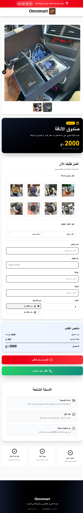

# omnimart — Next.js E-commerce Landing Page

Next.js 16 + TypeScript + Tailwind CSS v4. Arabic RTL landing page for "صندوق الأناقة" (Elegance Box) gift box product (watch + perfume). Google Sheets + Resend email integration.

## Screenshot



## Quick Start

```bash
cd omnimart
npm install
# .env.local already configured with credentials
npm run dev                 # http://localhost:3000
```

## Environment Variables

Required in `.env.local`:
- `GOOGLE_SERVICE_ACCOUNT` — Google Sheets API service account JSON
- `GOOGLE_SHEET_ID` — Target Google Sheet ID
- `RESEND_API_KEY` — Resend email service API key

## Commands

```bash
npm run dev     # Development server (Turbopack)
npm run build   # Production build
npm run start   # Production server
npm run lint    # ESLint
```

## Features

- Arabic RTL layout
- 8 watch models + 2 box images + logo
- 58 Algerian wilayas with delivery fees (domicile vs desk pickup)
- Dual submission: "Confirm & Send" (Sheets + Email) + "Order via WhatsApp"
- Countdown timer, price calculator
- Google Sheets append + Resend email notifications
- Server Actions for form handling

## Git

- Remote: https://github.com/oguenfoude/omnimart.git
- Branch: main